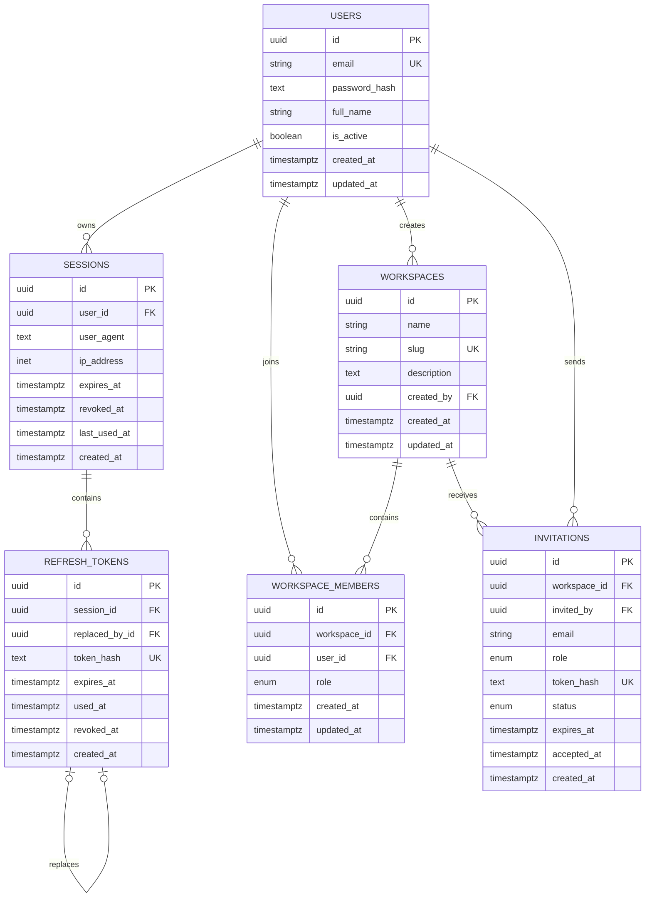

# AgentHub — Database Architecture

## Database Strategy

- Primary relational database: PostgreSQL
- ORM: SQLAlchemy 2.x Async
- Database migrations: Alembic
- Primary key strategy: UUID
- Timestamp strategy: UTC with TIMESTAMPTZ
- Multi-tenancy strategy: Shared database with tenant-scoped records
- Vector database: Qdrant
- Cache and background processing: Redis

## Phase 1 Entity Relationship Diagram

## Workspace Roles

- OWNER: Workspace ownership and administrative operations.
- ADMIN: Authorized workspace management operations.
- MEMBER: Authorized access to workspace resources and AI capabilities.

Roles are associated with workspace memberships rather than global user accounts.

## Database Constraints

- User emails must be normalized and unique.
- Workspace slugs must be unique.
- Workspace membership must be unique across workspace_id and user_id.
- Refresh token hashes must be unique.
- Invitation token hashes must be unique.
- A replacement refresh token must belong to the same session.
- Workspace creation and owner membership creation must be transactional.
- Refresh token rotation must be transactional.
- Invitation acceptance must be transactional.
- Workspace ownership must never be accidentally removed.
- Foreign key deletion behavior must be explicitly defined before migrations.

## Tenant Isolation

- Every tenant-owned resource must belong to a workspace.
- Workspace identifiers supplied by clients must be validated against authenticated memberships.
- Tenant-scoped queries must enforce workspace isolation.
- Document permissions must also be enforced during vector retrieval.
- MCP tools must independently validate tenant and resource authorization.
- Conversation and checkpoint access must be scoped to authorized users and workspaces.

## Security

- Store password hashes, never plaintext passwords.
- Store refresh token hashes, never raw refresh tokens.
- Store invitation token hashes, never raw invitation tokens.
- Enforce session expiration and revocation.
- Implement refresh token rotation and reuse detection.
- Never store external API credentials in plaintext.
- Avoid collecting unnecessary personal information.

## Migration Strategy

Database tables will be introduced incrementally through Alembic migrations as each business module is implemented.

Do not create tables for future phases before their requirements are finalized.

## Future Database Modules

- Document management and ingestion
- Integrations and tickets
- Conversations and messages
- Agent execution and tool execution
- Human approvals
- Evaluation datasets and results
- Audit logs and guardrail events

The initial schema is a logical design proposal. Physical indexes, deletion policies, detailed constraints and migration definitions will be finalized during implementation.